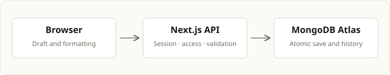

# Architecture

I built the workspace and API in one Next.js application and chose MongoDB Atlas for JSON documents and atomic, version-checked writes.

## Responsibilities

| Layer                       | Responsibility                                                    |
| --------------------------- | ----------------------------------------------------------------- |
| React, Chakra UI and Tiptap | Editing draft, formatting, save feedback and dialogs              |
| Next.js API                 | Session checks, validation, permissions and document operations   |
| MongoDB Atlas               | Profiles, credentials, sessions, documents, comments and presence |
| Vercel                      | Hosting, server-only environment variables and GitHub deployments |

## Storage and access

I embed shares and bounded history in each document. A save checks permission and the expected version in one atomic update. Stale saves return HTTP 409; the browser retains the draft and offers a copy or reload.

| Role   | Allowed actions                                  |
| ------ | ------------------------------------------------ |
| Owner  | Edit, export, comment, restore and manage shares |
| Editor | Edit, export, comment and restore                |
| Viewer | Read, export, comment and preview history        |

I store password hashes separately from profiles. Sessions use opaque tokens in HTTP-only cookies; MongoDB stores only their SHA-256 digests. Passwords use salted scrypt. Authentication has rate limits, and mutations check request origin.

## Collaboration and files

- Presence polls every 3 seconds, heartbeats every 6 seconds and expires after 20 seconds. Only clean editors refresh remote saved content.
- Comments enforce author and document-role permissions in the API.
- Restore creates a new version. History retains at most 50 previous snapshots within 6,000,000 BSON bytes.
- Imports validate UTF-8 `.txt` and `.md` files up to 1 MiB and store Tiptap JSON. Original binaries are not retained.
- PDF uses bundled Noto Sans fonts and a 200-page limit. Unsupported glyphs return an explicit error; Markdown preserves the text.

I use a dedicated Atlas cluster and keep credentials server-side. Database setup is additive; migration verifies copied records and preserves the source.

For delivered checks and scope limits, see the [report](../SUBMISSION.md).
